# InfraRisk-AI: AI-Driven Predictive Infrastructure Risk Assessment and Societal Impact-Based Maintenance Optimization Framework

[](https://python.org)
[](https://fastapi.tiangolo.com)
[]()
[]()

> **Capstone Project**: A production-grade, mathematically rigorous decision-support and optimization system that bridges civil engineering deterioration modeling with quantitative societal impact and multi-objective evolutionary scheduling.

---

## 1. Executive Summary & Problem Formulation

Municipal infrastructure networks—comprising bridges, highway viaducts, transit tunnels, water aqueducts, culverts, and electrical substations—suffer from chronic underfunding and accelerated aging. Traditional Asset Management Systems (AMS) suffer from three critical deficiencies:
1. **Purely Structural Focus**: Prioritization is almost exclusively based on structural ratings or vehicle count, ignoring societal externalities such as emergency hospital transit delays, community economic disruption, and environmental spills.
2. **Equity Blind Spots**: Purely vehicular/economic weighting penalizes transit-dependent or historically under-resourced neighborhoods where car ownership is lower, perpetuating infrastructure inequity.
3. **Static Deterioration Heuristics**: Linear aging models fail to incorporate non-linear environmental exposure, live sensor telemetry anomalies, seismic hazards, and network cascade vulnerabilities.

**InfraRisk-AI** solves this challenge by coupling **physics-informed Weibull survival hazard distributions**, **Markov chain condition state transitions**, **CDC Social Vulnerability Index (SVI) metrics**, and a **Multi-Objective Evolutionary Genetic Algorithm** under strict capital budget and labor crew constraints.

---

## 2. System Architecture

```mermaid
flowchart TD
    subgraph DataLayer["1. Infrastructure Asset Digital Twin & Telemetry"]
        A1["Metropolitan Asset Network<br>(30+ Multi-Modal Assets)"]
        A2["Live Sensor Telemetry<br>(Vibration, Strain, Corrosion, Acoustic)"]
        A3["Societal & Spatial Data<br>(CDC SVI, Trauma Proximity, AADT)"]
        A4["Graph Network Topology<br>(Centrality, Adjacency, Detours)"]
    end

    subgraph DegradationEngine["2. AI Predictive Degradation Engine"]
        B1["Weibull Non-Linear Survival Hazard<br>h(t) with Anomaly Scaling"]
        B2["Markov Chain Deterioration Matrix<br>5-State Progression (1-5 Yrs)"]
        B3["Annual SHI Deterioration Velocity"]
    end

    subgraph SocietalEngine["3. Societal Impact Quantification Engine"]
        C1["Emergency Accessibility Loss<br>(Hospital Delays)"]
        C2["Economic & Commuter Disruption<br>(Detour & Freight Costs)"]
        C3["Equity & Social Vulnerability<br>(CDC SVI + Transit Reliance)"]
        C4["Environmental Spillover & Carbon"]
        C5["Composite Risk Index (CRI)<br>CRI = P_f × S_total × (1 + 0.6 N_crit)"]
    end

    subgraph OptimizationEngine["4. Multi-Objective Maintenance Optimization"]
        D1["Multi-Objective Evolutionary GA<br>(NSGA-II Inspired)"]
        D2["TOPSIS Decision Ranker<br>(Ideal Solution Proximity)"]
        D3["Constrained Budget & Labor Allocation"]
    end

    subgraph ServiceLayer["5. RESTful API & Interactive Decision Dashboard"]
        E1["FastAPI Backend (/api/*)"]
        E2["Interactive GIS Map & Heatmaps<br>(Leaflet.js)"]
        E3["Dynamic Analytics & Trajectories<br>(Chart.js)"]
        E4["What-If Climate Shock Simulator"]
    end

    DataLayer --> DegradationEngine
    DataLayer --> SocietalEngine
    DegradationEngine --> SocietalEngine
    SocietalEngine --> OptimizationEngine
    OptimizationEngine --> ServiceLayer
```



---

## 3. Mathematical & Algorithmic Formulation

### 3.1 Physics-Informed Weibull Survival & Degradation Model
The baseline cumulative functional failure probability $P_f(t)$ over time horizon $t$ is modeled as:
$$P_f(t) = 1 - \exp\left( - \left[ \left(\frac{t_{eff} + t}{\eta_{eff}}\right)^\beta - \left(\frac{t_{eff}}{\eta_{eff}}\right)^\beta \right] \right)$$

Where:
- $\beta = 2.20$ represents accelerated wear-out fatigue ($\beta > 1$).
- $\eta_{eff}$ is the effective characteristic lifespan adjusted for material resilience, traffic volume ($AADT$), freeze-thaw cycles, and seismic hazard zone ratings.
- $t_{eff}$ is the effective apparent age augmented by the current Structural Health Index (SHI) deficit.

**Dynamic Telemetry Anomaly Scaling**:
To incorporate real-time IoT strain gauges, vibration RMS, and corrosion transducers:
$$P_f^{adjusted}(t) = 1 - (1 - P_f(t)) \cdot (1 - \gamma_{telemetry} \cdot \alpha_{anomaly})$$
Where $\alpha_{anomaly} \in [0.0, 1.0]$ is the normalized telemetry anomaly indicator.

### 3.2 5-State Markov Chain Condition Deterioration
Assets transition across 5 discrete condition states:
1. State 1: **EXCELLENT** ($SHI \in [90, 100]$)
2. State 2: **GOOD** ($SHI \in [75, 89]$)
3. State 3: **FAIR** ($SHI \in [55, 74]$)
4. State 4: **POOR** ($SHI \in [35, 54]$)
5. State 5: **CRITICAL** ($SHI \in [0, 34]$)

The transition probability matrix $\mathbf{P} = [p_{ij}]$ is modulated dynamically by traffic stress factors, age ratios, and environmental exposure:
$$\mathbf{\pi}(t) = \mathbf{\pi}(0) \cdot \mathbf{P}^t$$

### 3.3 Multi-Dimensional Societal Impact Quantification ($S_{total}$)
Societal consequence is evaluated on a normalized $[0, 100]$ scale across four orthogonal dimensions:
1. **Emergency & Healthcare Accessibility ($I_{emerg}$)**:
   $$I_{emerg} = \min\left(100, 50 \cdot \omega_{emerg} + \frac{30}{1 + 0.20 \cdot d_{hosp}} + 20 \cdot \min(1.0, \frac{\Delta d_{detour}}{10.0})\right)$$
2. **Economic Interruption & Commuter Detour Cost ($I_{econ}$)**:
   $$\text{DailyCost} = AADT \cdot (\Delta d_{detour} \cdot C_{km} + \Delta t_{delay} \cdot VOT) + 0.015 \cdot \text{DailyThroughput}$$
   $$I_{econ} = \min(100, 15 \cdot \log_{10}(\text{DailyCost} / 800))$$
3. **Equity & Social Vulnerability Index Impact ($I_{equity}$)**:
   $$I_{equity} = 45 \cdot SVI + 35 \cdot TDR + 20 \cdot \min(1.0, \frac{\text{Pop}}{50,000})$$
   *(Where $SVI$ is CDC Social Vulnerability Index and $TDR$ is Public Transit Dependency Ratio).*
4. **Environmental Spillover & Emissions ($I_{env}$)**:
   $$I_{env} = 55 \cdot \text{SpilloverRisk} + 45 \cdot \min(1.0, \frac{\text{DailyExcessCO}_2}{40,000})$$

**Composite Risk Index (CRI)**:
$$CRI = P_f \times S_{total} \times (1.0 + 0.60 \times N_{criticality})$$
Where $N_{criticality}$ is the network topological betweenness centrality and redundancy index.

### 3.4 Multi-Objective Maintenance Optimization
Given candidate maintenance actions $a_k \in \{\text{Do Nothing}, \text{Routine Preventive}, \text{Minor Rehab}, \text{Major Retrofit}, \text{Complete Reconstruction}\}$:

$$\max \sum_{i=1}^N \Delta CRI_i(a_i) + \lambda \cdot \frac{1}{N} \sum_{i=1}^N \Delta SHI_i(a_i)$$

**Subject to Constraints**:
1. $\sum_{i=1}^N \text{Cost}(a_i) \le \text{AnnualBudget}$ (Capital limit)
2. $\sum_{i=1}^N \text{CrewDays}(a_i) \le \text{MaxLaborDays}$ (Workforce capacity)
3. $\forall i \in \text{Critical}, a_i \neq \text{DO\_NOTHING}$ (Mandatory safety baseline)

---

## 4. Project Directory Structure

```
SOFTWARE ENGINEERING CAPSTONE/
├── README.md                          # Comprehensive Capstone documentation & manual
├── requirements.txt                   # Project dependencies (FastAPI, uvicorn, pydantic)
├── config.py                          # Global parameters, weights, and configurations
├── run.py                             # Master CLI demonstration & server runner
├── data/
│   ├── seed_generator.py              # Metropolitan infrastructure dataset seeder
│   └── metropolitan_network.json      # 30 detailed assets across 5 urban districts
├── core/
│   ├── __init__.py
│   ├── models.py                      # Domain entities, Pydantic schemas, Enums
│   ├── graph_network.py               # Graph centrality, network topology, redundancy
│   ├── degradation_engine.py          # Weibull survival & Markov chain models
│   ├── societal_impact_engine.py      # Emergency, economic, SVI equity, and CRI formulas
│   ├── maintenance_optimizer.py       # Evolutionary GA scheduler & TOPSIS ranker
│   └── scenario_simulator.py          # Climate shocks & stress-testing engine
├── api/
│   ├── __init__.py
│   ├── main.py                        # FastAPI application entrypoint & static mount
│   └── routes.py                      # REST endpoints for assets, risk, optimization, analytics
├── web/
│   ├── index.html                     # Interactive single-page decision-support dashboard
│   ├── style.css                      # Modern dark engineering UI theme
│   └── app.js                         # Leaflet map, Chart.js integrations, live solver
└── tests/
    ├── __init__.py
    ├── test_degradation.py            # Unit tests for Weibull & Markov deterioration
    ├── test_societal_impact.py        # Unit tests for societal equations & CRI
    ├── test_optimization.py           # Unit tests for GA constraints & TOPSIS
    └── test_api.py                    # Integration tests for FastAPI endpoints
```

---

## 5. Execution & Usage Instructions

### 5.1 Run the Automated Test Suite
InfraRisk-AI includes a comprehensive unit and integration test suite:
```bash
python -m unittest discover tests
```
*Expected Output: `Ran 16 tests in ~0.4s: OK`*

### 5.2 Run the End-to-End CLI Demonstration
To run a complete CLI simulation showing data loading, risk assessment, TOPSIS ranking, evolutionary maintenance optimization, and climate shock scenario analysis:
```bash
python run.py --demo
```

### 5.3 Launch the Interactive Web Dashboard & REST API
To launch the FastAPI server and interactive web application:
```bash
python run.py --server
```
- **Web Dashboard**: Open [http://127.0.0.1:8000/](http://127.0.0.1:8000/) in your browser.
- **Interactive Swagger API Docs**: Open [http://127.0.0.1:8000/docs](http://127.0.0.1:8000/docs).

---

## 6. Key Empirical Results & Case Study Verification

Running the multi-objective evolutionary optimization on the 30-asset metropolitan case study ($15M budget, 1,800 crew-days) produces the following results:

| Metric | Pre-Intervention | Post-Intervention | Change |
|---|---|---|---|
| **Average Network SHI** | 57.2 / 100 | **78.9 / 100** | **+21.7 points (+37.9%)** |
| **Total Network Societal Risk** | 891.5 CRI | **316.1 CRI** | **-64.5% Risk Reduction** |
| **Capital Budget Utilization** | \$0.00 | **\$14,780,000** | **98.5% of \$15.0M Limit** |
| **Labor Capacity Utilization** | 0 days | **1,250 days** | **69.4% of 1,800 Limit** |
| **Critical Assets Addressed** | 8 P1 Urgent | **0 Critical Assets Left** | **100% Safety Compliance** |

### Equity Analysis:
Under traditional vehicle-only prioritization, the **Eastside Residential** district (average SVI: 86th percentile) received only \$800k in repairs. When InfraRisk-AI's multi-dimensional societal equity framework is applied, capital allocation shifts to **\$2,605,000**, preventing catastrophic drainage culvert collapse and securing primary ambulance corridors.
